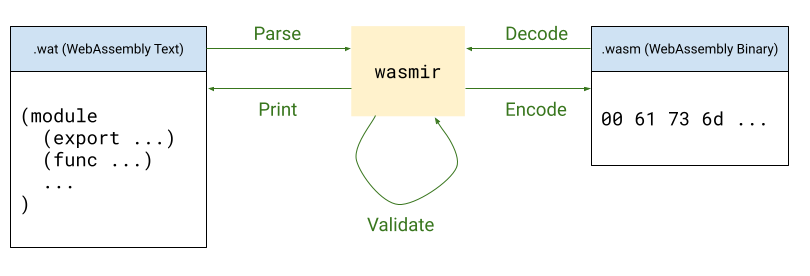

# watgo

[](https://github.com/eliben/watgo/actions/workflows/ci.yml)
[](https://pkg.go.dev/github.com/eliben/watgo)

----

<p align="center">
  
</p>

**W**eb**A**ssembly **T**oolkit for **Go** (**watgo**) to parse [WASM](https://www.w3.org/TR/wasm-core-2/) text or decode WASM binary into internal data
structures, allowing conversions, validation, and testing-oriented execution.

### WASM feature support and proposals

Initially, we aim to support all the [finished proposals](https://github.com/WebAssembly/proposals/blob/main/finished-proposals.md)
without any flags or feature selection. Finished proposals are part of the WASM
spec.

If there's a request to support [active proposals](https://github.com/webassembly/proposals),
we'll consider employing explicit feature flags to gate this support.

### Installation

To install the CLI into your Go bin directory:

```sh
go install github.com/eliben/watgo/cmd/watgo@latest
```

To run it directly from a checkout without installing:

```sh
go run ./cmd/watgo
```

To run it straight from the module path without installing:

```sh
go run github.com/eliben/watgo/cmd/watgo@latest
```

### Go API

The public Go API is documented on [`pkg.go.dev`](https://pkg.go.dev/github.com/eliben/watgo),
including runnable examples for the high-level functions in `package watgo`.

Runtime support is available in package
[`wasmvm`](https://pkg.go.dev/github.com/eliben/watgo/wasmvm). `wasmvm` is a
small interpreter for validated `wasmir.Module` values; it can instantiate
modules, call exported functions and provide Go callbacks for function imports.
It is intended for testing and experimentation, not for high-performance wasm
execution.

<p align="center">
  
</p>

### CLI

`watgo` currently provides basic `parse`, `print`, `validate`, and
`interpret` subcommands.

Where applicable, for  supported subcommands and flags, the CLI aims to stay
compatible with [`wasm-tools`](https://github.com/bytecodealliance/wasm-tools).

Examples:

```sh
# Compile WAT text to a WASM binary file.
watgo parse input.wat -o output.wasm

# Validate a WAT file.
watgo validate input.wat

# Validate a WASM binary.
watgo validate input.wasm

# Instantiate a module and invoke an exported function with wasmvm.
watgo interpret input.wat --invoke add 3 5

# Provide simple numeric host printing imports while interpreting.
# Run 'watgo help interpret' for more details on how this works.
watgo interpret input.wat --host-print --invoke run

# Read WAT from stdin and write WASM to stdout.
cat input.wat | watgo parse > output.wasm
```

For full command-line help, run:

```sh
watgo help
```

### Testing

Run the full test suite with:

```sh
go test ./...
```

Some of the end-to-end tests execute compiled modules under Node.js, so Node is
required for the full suite (set the env var `WATGO_NODE_TESTS=0` to disable all
Node-dependent tests). Selected spec and WABT-style execution coverage also runs
through `wasmvm`.

For more detail on the different test sets and how to refresh them from
upstream, see [`tests/README.md`](tests/README.md).

Fuzz targets check the binary decoder and WAT parser for crashes on arbitrary
input; parse and decode errors are expected. Their seed inputs run as part of
normal tests. To generate new inputs, run either target explicitly:

```sh
go test ./internal/binaryformat -run '^$' -fuzz '^FuzzDecodeModule$' -fuzztime=5m -parallel=2
go test ./internal/textformat -run '^$' -fuzz '^FuzzParseModule$' -fuzztime=5m -parallel=2
```

Adjust `-fuzztime` for longer runs and `-parallel` to control worker count. Go
saves failing inputs under the package's `testdata/fuzz/` directory; keep them
as regression cases after fixing the bug.

### License

The source code of watgo is in [the public domain](LICENSE). Certain vendored
test scripts retain their original licenses:

- `tests/wasmspec`
  
  * Source: https://github.com/WebAssembly/spec/
  * License: Apache License 2.0
  * See: `tests/wasmspec/LICENSE`

- `tests/wabt-interp`
  
  * Source: https://github.com/WebAssembly/wabt
  * License: Apache License 2.0
  * See: `tests/wabt-interp/LICENSE`
